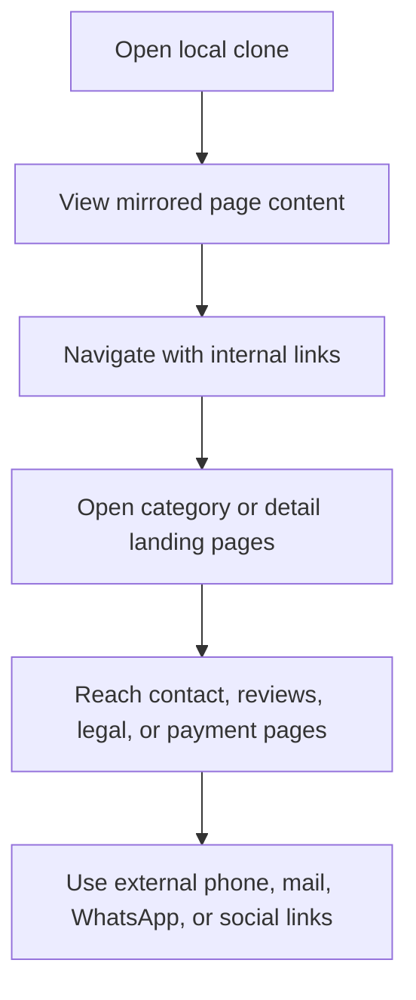

## 1. Product Overview
Build a faithful local clone of `https://www.fortunecontacts.com/` that preserves the public site structure, page content, visual design language, navigation, and downloadable/media assets.
- Main purpose: reproduce the complete public-facing marketing website for offline/local hosting, review, and future editing without relying on the original server at runtime.
- Target value: provide a maintainable mirror of the current public site, including approximately 102 indexed routes, industry landing pages, legal pages, review pages, and shared images/assets.

## 2. Core Features

### 2.1 User Roles
No authenticated roles are required for the clone. The project mirrors publicly accessible content only.

### 2.2 Feature Module
1. **Homepage**: hero section, trust messaging, service overview, FAQ, testimonials, CTA, footer links.
2. **Standard content pages**: About Us, Contact Us, Reviews, Terms, Privacy, payment-related and support pages.
3. **Industry category pages**: top-level vertical pages such as automotive, education, finance, healthcare, chemical, aviation, real estate, and related hub pages.
4. **Industry detail landing pages**: long-tail service pages such as individual email list pages and related “more industries” pages.
5. **Shared navigation and footer system**: header menus, route links, CTA buttons, external social/contact links.
6. **Asset preservation**: site images, logos, icons, CSS, JavaScript, and other page-linked media required for rendering.
7. **Local browsing support**: converted internal links and asset paths so the mirrored project can be served locally without broken navigation.

### 2.3 Page Details
| Page Name | Module Name | Feature description |
|-----------|-------------|---------------------|
| Home | Hero | Preserve headline, CTA, supporting copy, and lead-generation positioning |
| Home | About preview | Mirror company summary and link to About page |
| Home | Key factors | Preserve icon/image-led selling points and benefits copy |
| Home | Process section | Keep the full multi-step data collection and verification narrative |
| Home | FAQ | Retain accordion-style or stacked question/answer content |
| Home | Testimonials | Mirror review cards, ratings, and external review links |
| Home | Quote/contact CTA | Preserve contact card, phone, email, and office location data |
| About Us | Company story | Preserve mission, supporting marketing content, and contact block |
| Contact Us | Office/contact info | Preserve head office, sales office, email, phone, and contact CTA |
| Reviews | Social proof | Mirror review summaries and supporting visual content |
| Legal pages | Policy content | Preserve privacy and terms text and footer navigation |
| Industry hubs | Category navigation | Preserve grouped industry/service entry points |
| Industry detail pages | Sales landing content | Preserve individual list descriptions, supporting sections, and CTAs |
| Global layout | Header/footer | Keep logo, menus, footer links, social links, and contact shortcuts |

## 3. Core Process
The user opens the local mirror, lands on the homepage or a deep-linked industry page, browses static content, follows internal links between industry pages and utility pages, and reaches contact/payment/external destinations without visual regressions or missing assets.

## 4. User Interface Design
### 4.1 Design Style
- Primary colors: preserve the original brand palette as closely as possible after asset and stylesheet capture
- Button style: retain the original CTA button styling, hover treatment, and link emphasis
- Typography: match the live site’s heading/body hierarchy and spacing as closely as possible
- Layout style: marketing-site layout with hero-first sections, image-backed content blocks, and repeated CTA panels
- Icon style suggestions: preserve existing iconography and raster graphics from the live site rather than replacing them

### 4.2 Page Design Overview
| Page Name | Module Name | UI Elements |
|-----------|-------------|-------------|
| Home | Hero | Logo, navigation, headline, CTA button, supporting image/background |
| Home | Feature blocks | Section headings, supporting images, multi-column benefit lists |
| Home | FAQ and testimonials | Content cards/rows, review links, rating visuals |
| About Us | Mission/story | Marketing copy, stats/content blocks, repeated contact CTA |
| Contact Us | Contact methods | Address cards, phone/email links, supporting imagery |
| Industry pages | Landing content | Page heading, explanatory copy, CTAs, repeated branding blocks |
| Footer | Shared footer | Legal links, social links, sitemap-style navigation |

### 4.3 Responsiveness
Desktop-first implementation, with responsive adaptation for tablet and mobile layouts. The clone should preserve readable text flow, image scaling, and navigable menus across breakpoints while staying visually faithful to the source site.
