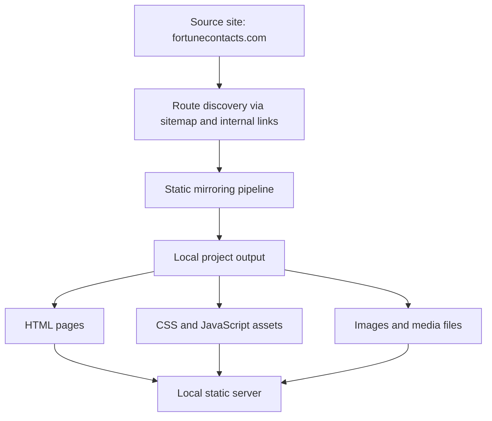

## 1. Architecture Design
The implementation will use a static mirror-first architecture so the public website can be reproduced with high fidelity and served locally with minimal transformation.

## 2. Technology Description
- Frontend: mirrored static HTML, CSS, JavaScript, and downloaded image/media assets
- Initialization Tool: none required for the first delivery; static site structure is more faithful than reimplementing in React for this request
- Backend: None
- Database: None
- Asset strategy: download all publicly referenced files needed for rendering, including logo, shared graphics, page images, stylesheets, and scripts
- Link strategy: convert internal links to local relative paths while preserving external links such as `mailto:`, `tel:`, WhatsApp, Google review, and social destinations

## 3. Route Definitions
| Route | Purpose |
|-------|---------|
| `/` | Homepage with hero, services, FAQ, testimonials, and contact CTA |
| `/About-Us` | Company overview and mission page |
| `/Contact-us` | Contact details and office information |
| `/fortune-contacts-reviews` | Reviews and social proof page |
| `/terms-and-conditions` | Terms page |
| `/privacy-policy` | Privacy page |
| `/<industry-or-service-page>` | Mirrored public landing pages from the sitemap, including category hubs and detail pages |

## 4. Mirroring Rules
1. Crawl all sitemap routes currently published in `https://www.fortunecontacts.com/sitemap.xml`.
2. Download required page dependencies for each route, including images, CSS, JavaScript, and other directly referenced public assets.
3. Preserve route names and generate matching local file paths so deep links remain usable when served from a local static server.
4. Convert internal absolute links to local references where possible.
5. Keep external links unchanged.
6. Preserve original text, layout structure, and branding assets unless a source asset fails to download; in that case, record the gap for follow-up.

## 5. Output Structure
| Path | Purpose |
|------|---------|
| `site/` | Root of the mirrored website |
| `site/index.html` | Local homepage |
| `site/<route>/index.html` | Mirrored nested routes |
| `site/assets/` | Downloaded CSS, JavaScript, images, fonts, and supporting media |

## 6. Verification Plan
### 6.1 Route Verification
- Confirm the mirrored output contains all sitemap routes that can be downloaded publicly.
- Spot-check representative pages from homepage, standard content pages, and long-tail industry pages.

### 6.2 Asset Verification
- Confirm logos, hero images, content images, and shared styles/scripts resolve locally.
- Check for broken asset references and fix path rewrites when needed.

### 6.3 Navigation Verification
- Confirm internal navigation between representative pages works in the local clone.
- Confirm external links remain intact and are not rewritten.

### 6.4 Rendering Verification
- Serve the mirrored output with a local static server and visually compare a sample of pages against the live site.
- Record any pages that require manual cleanup because of server-side behavior or third-party hosted assets.
